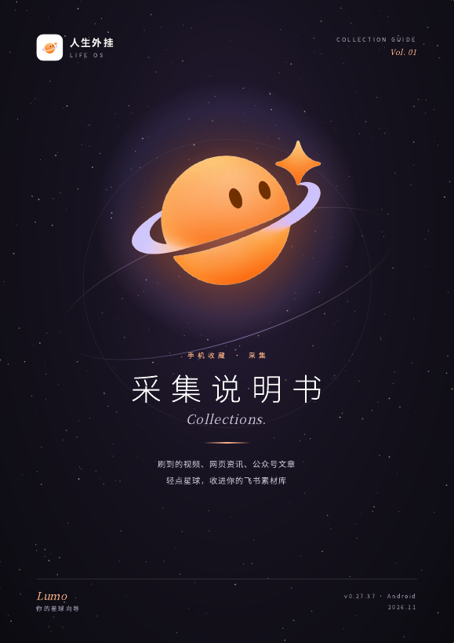
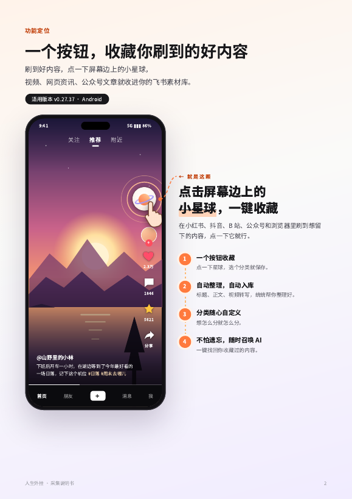

<p align="center"></p>

<h1 align="center">人生外挂 · Life OS</h1>
<p align="center">你的人生向导 Lumo：帮你拆目标、做决策，也替你记住看过的好内容。</p>

---

## 两部分功能

### 一、人生向导：计划与决策
- **计划模式**：根据你自己的情况，把大目标拆成小目标，再落到每天能执行的具体一步。
- **决策模式**：面对要做的决定，从人生层面帮你分析利弊、代价和风险，辅助你做判断。
- **Lumo 的知识仓库**：可以导入书籍 Skill、人物经验和方法论 Skill，让 Lumo 结合这些方法给建议。

### 二、第二大脑：记住你看过的，需要时找得到
- **一键收藏**：刷到想留下的内容，点屏幕边上的小星球，选个分类就保存。支持小红书、抖音、B 站及部分网站资讯，公众号和视频号优化中。
- **自动整理，自动入库**：标题、正文、视频转写稿自动写进你自己的飞书多维表格。
- **分类随心自定义**：想怎么分就怎么分，每个分类一张表。
- **不怕遗忘，随时召唤 AI**：在人生向导里点「收藏库」，用一句模糊的话就能把收藏找回来。

> **当前进度**：计划与决策部分还在持续完善中。我们先优先把「第二大脑」做扎实：收得进来、找得出来。附带的《采集说明书》也主要讲这一部分。

<p align="center"></p>

## 下载

到右侧 **[Releases](../../releases)** 下载最新版：

| 文件 | 说明 |
|---|---|
| `人生外挂-v0.27.41.apk` | Android 安装包（约 170 MB，内置离线语音转写模型） |
| `人生外挂-采集说明书.pdf` | 图文教程：连接飞书、开启星球按钮、收藏、查找、接入 AI |

## 安装

1. 用 Android 手机下载 APK，点开安装；如提示「未知来源」，按提示允许本次安装。
2. 已经装过旧版的，**直接覆盖安装即可，不要先卸载**，否则手机里的收藏和设置会被清掉。
3. 第一次打开会看到开场动画和隐私政策，同意后开始使用。
4. 按《采集说明书》完成配置，大约 10 分钟。

> **关于无障碍权限的提示**：开启「星球收藏按钮」需要在系统设置里打开无障碍服务。因为 App 尚未上架应用商店，目前属于内测阶段，系统弹出警告是正常现象。星球按钮只在你点击它时读取当前页面的分享入口，不读取聊天记录和密码。

## 系统要求

- Android 8.0 及以上
- 一个飞书账号（个人版即可）
- 可选：DeepSeek 等 AI 的 API Key（用于 AI 查找和总结）
- iPhone 版正在开发中

## 校验安装包

下载后可以核对 SHA-256，确认文件完整、没有被改动：

```
f86fa654a4813fd9437830842929a507ee8de3779e1ba236acb88fcfac81871b  人生外挂-v0.27.41.apk
```

签名证书 SHA-256 指纹：`07691f02941e1614f0bcc8876ab234a007ad2d387cc2f5ecad24d8282e9e62f5`

## 版权声明

「人生外挂」由小红书 **@咖喱刘肉饭🍛**（gali_pear）与 **@吴师傅**（42947063303）原创开发，软件、界面设计、名称、Lumo 形象及说明书的著作权归原创作者所有。

未经书面授权，禁止抄袭仿冒、反编译或二次打包分发、二次转卖或收费分发。本仓库仅提供安装包与说明书，不包含源代码。

联系邮箱：2320174497@qq.com
